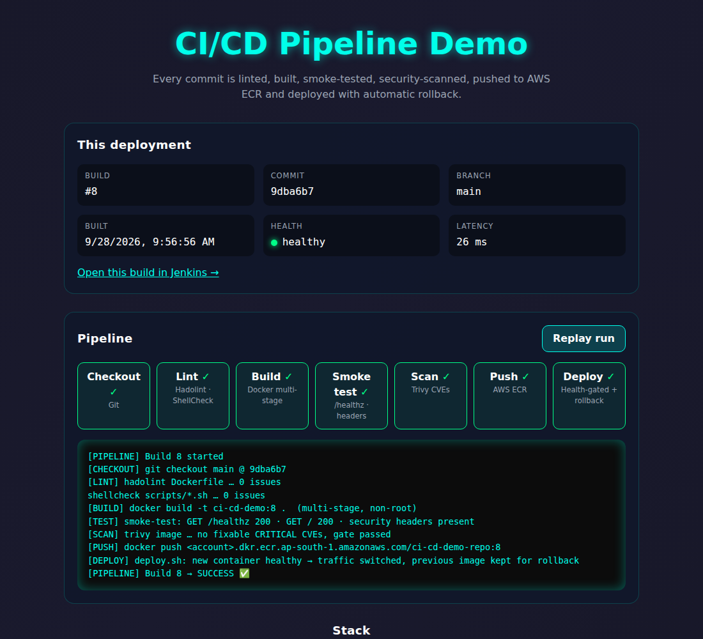

# CI/CD Pipeline Demo

[](https://github.com/Aslam-space/ci-cd-pipeline-demo/actions/workflows/ci.yml)

A static website that is **linted, built, smoke-tested, vulnerability-scanned, pushed to AWS ECR and deployed with automatic rollback** on every push to `main`.

The site shows the real build that is running: build number, commit, branch, build time, a link back to the Jenkins run, and a live health check against the container.



## Pipeline

```
 git push ──► GitHub ──webhook──► Jenkins
                 │
                 └──► GitHub Actions (PR checks: lint · build · smoke test · Trivy)

 Jenkins:  Checkout ─► Lint ─► Build ─► Smoke Test ─► Security Scan ─► Push to ECR ─► Deploy ─► Verify
                      │                                                  (main only)   (main only)
              Hadolint + ShellCheck
```

| Stage | What it does | Fails the build when |
|---|---|---|
| **Lint** | Hadolint on the `Dockerfile`, ShellCheck on `scripts/`, run in parallel | Any lint issue |
| **Build** | Multi-stage Docker build; bakes build metadata into `/build-info.json` | Build error |
| **Smoke Test** | Runs the image read-only with all capabilities dropped, then runs `scripts/smoke-test.sh` and `nginx -t` | Health, content, assets, metadata, security headers or 404 handling are wrong |
| **Security Scan** | Trivy scans the image; the full report is archived as a build artifact | A fixable **CRITICAL** CVE is found |
| **Push to ECR** | Tags `BUILD_NUMBER`, short commit SHA and `latest`; creates the repo with scan-on-push if missing; account ID is looked up via STS, not hard-coded | Push/auth error |
| **Deploy** | `scripts/deploy.sh`: parks the old container, starts the new one, waits for the Docker `HEALTHCHECK` | New container is unhealthy → **automatic rollback** to the previous container |
| **Verify** | Re-runs the smoke test against the live site | Live site is wrong |

## Container hardening

- Non-root `nginxinc/nginx-unprivileged` base image, listening on port 8080
- Runs with `--read-only`, `--cap-drop ALL` and `no-new-privileges`
- Built-in `HEALTHCHECK` on `/healthz`
- Strict Content-Security-Policy (no inline scripts or styles), `X-Frame-Options`, `nosniff`, `Referrer-Policy`, `Permissions-Policy`; nginx version hidden
- Whitelist `.dockerignore`: only `app/` and the nginx config enter the build context
- Build-arg values are sanitized before they are written to `build-info.json`
- OCI image labels (revision, version, created, source)

## Repository layout

```
app/                  Website (served as-is)
  index.html
  assets/             styles.css, app.js
  images/             architecture diagram
docker/nginx.conf     nginx server config (headers, caching, /healthz)
scripts/
  deploy.sh           Health-gated deploy with automatic rollback
  smoke-test.sh       HTTP smoke tests used locally, in Jenkins and in GitHub Actions
Dockerfile            Multi-stage, non-root production image
Jenkinsfile           Full CI/CD pipeline
.github/workflows/    GitHub Actions PR checks
Makefile              Local shortcuts
docs/                 Screenshot, certificate
```

## Run it locally

Requires Docker (and `make`).

```bash
make test        # build, run on http://localhost:8080 and smoke-test
make run         # just build and run
make lint        # Hadolint + ShellCheck
make scan        # Trivy HIGH/CRITICAL report
make clean       # stop and remove
```

Without `make`:

```bash
docker build -t ci-cd-demo:local .
docker run -d --name ci-cd-demo -p 8080:8080 --read-only --tmpfs /tmp --cap-drop ALL ci-cd-demo:local
scripts/smoke-test.sh http://localhost:8080
```

## Jenkins setup

1. Agent with **Docker**, the **AWS CLI** and **curl**. The Jenkins user must be able to run `docker`.
2. Plugins: Pipeline, Git, Credentials Binding, CloudBees AWS Credentials, Timestamper.
3. Credential `aws-cred-id` (type *AWS Credentials*) with permission to push to ECR and call `sts:GetCallerIdentity`.
4. Create a **Pipeline from SCM** job pointing at this repo (or a Multibranch job — non-`main` branches build, test and scan but do not push or deploy).
5. GitHub webhook → `http://<jenkins-host>:8080/github-webhook/`, with *GitHub hook trigger for GITScm polling* enabled on the job.

Settings in the `Jenkinsfile` `environment` block: `AWS_REGION` (default `ap-south-1`), `ECR_REPO` (default `ci-cd-demo-repo`). Build parameters: `DEPLOY` and `HOST_PORT` (default `80`).

The Deploy stage runs the site on the Jenkins host itself (the same EC2 instance). Open port 80 in its security group.

## Manual deploy / rollback

```bash
# Deploy a specific build from ECR (health-gated, rolls back on failure)
scripts/deploy.sh <account>.dkr.ecr.ap-south-1.amazonaws.com/ci-cd-demo-repo:42

# Roll back = deploy an earlier tag
scripts/deploy.sh <account>.dkr.ecr.ap-south-1.amazonaws.com/ci-cd-demo-repo:41
```

Environment overrides: `CONTAINER_NAME`, `HOST_PORT`, `HEALTH_TIMEOUT`, `AWS_REGION`.

## Tech stack

Jenkins · GitHub Actions · Docker · nginx · Trivy · Hadolint · ShellCheck · AWS ECR · AWS EC2
